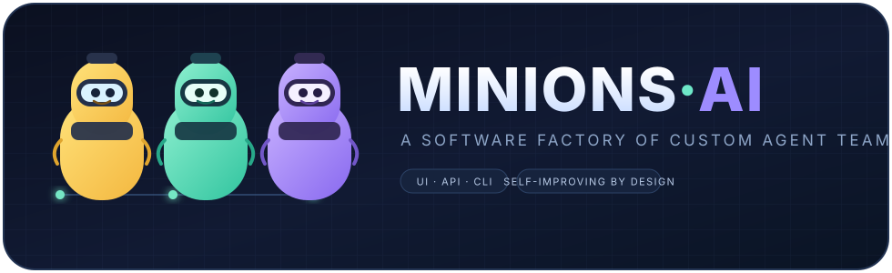
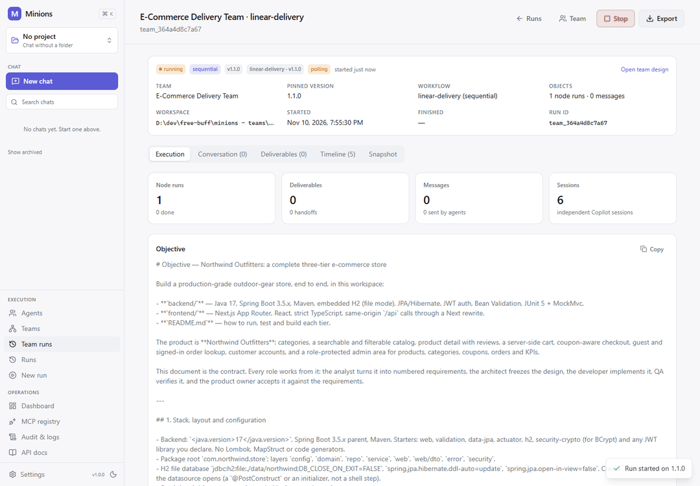
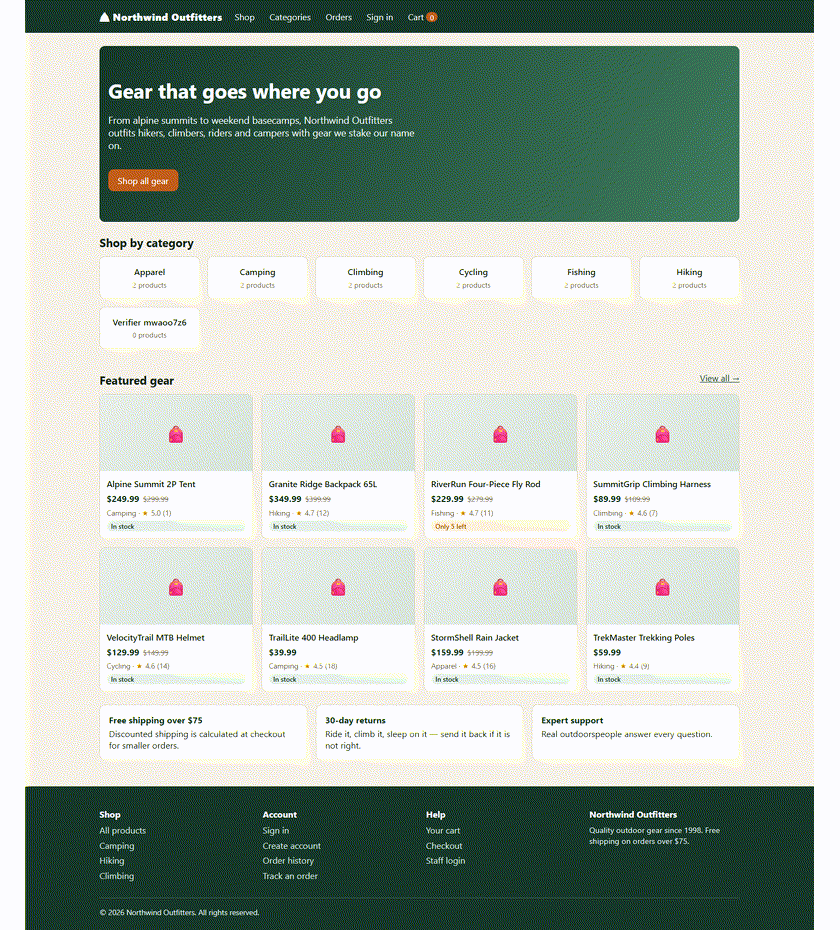
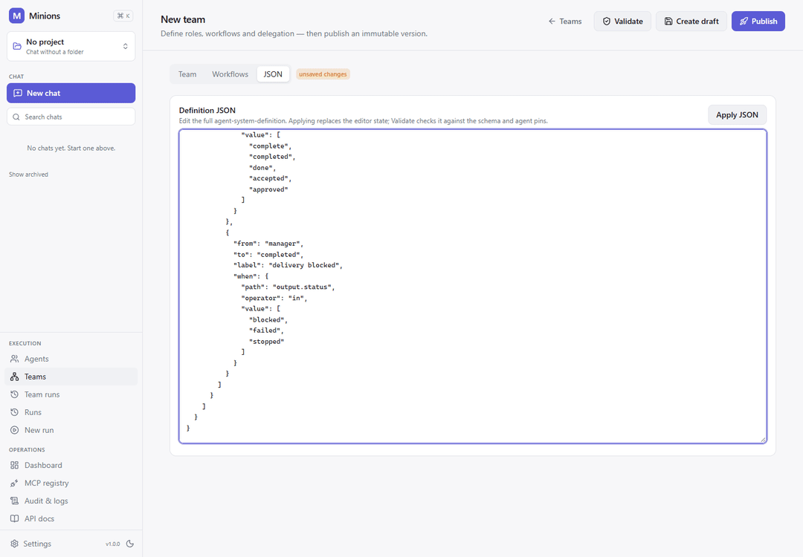
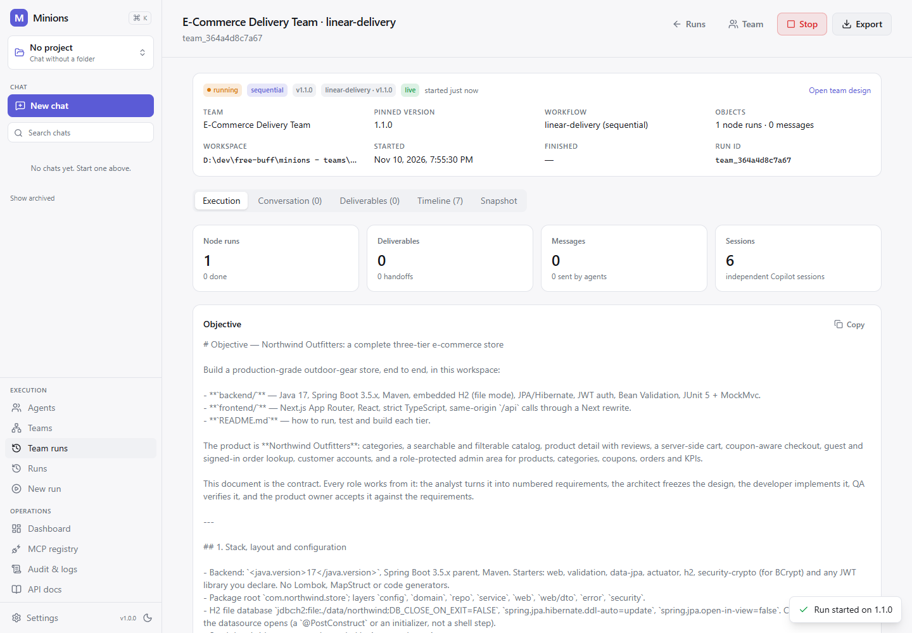
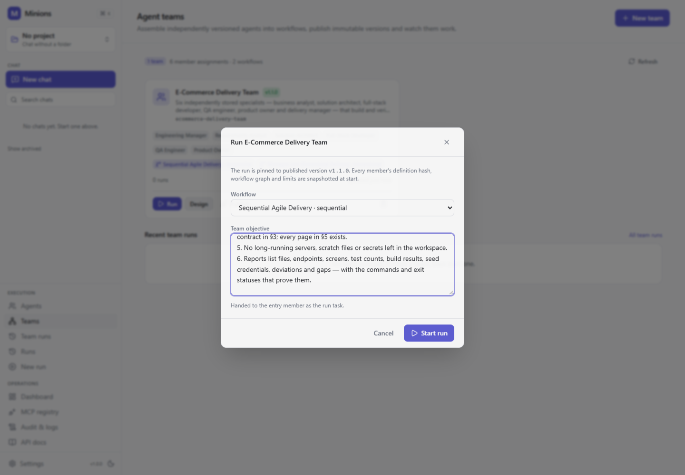
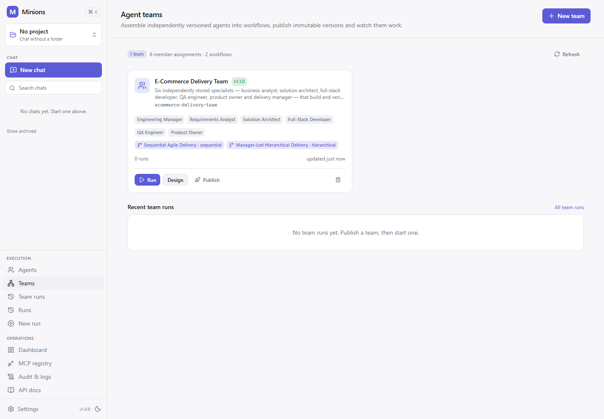

<p align="center">
  
</p>

<h1 align="center">Minions-ai</h1>

<p align="center"><strong>A fully configurable software factory of custom AI agent teams — ship to market faster, and let every run make the next one smarter.</strong></p>

<p align="center">
  <a href="https://github.com/siddharth-mishra-28/minions-ai/releases/latest"></a>
  
</p>

Minions-ai is a local-first delivery platform for teams of AI agents. Every role, model, tool, permission, memory scope and workflow is yours to define. The shipped **Software Delivery Team** is a working template, not a fixed pipeline: requirements, architecture, implementation and independent QA are five editable agents connected by a workflow you control. Each run records its evidence, and agents accumulate episodes, lessons and feedback so the next delivery starts further ahead.

The whole platform ships as **one self-contained executable per operating system** for Windows, macOS and Linux — with a React cockpit, REST API, CLI and A2A surface around the same execution engine. Bring your own model provider; keys stay in a local encrypted vault.



## Why a software factory, not another chat box

- **Ship sooner.** Reusable role agents, pinned team versions and bounded rework loops cut the distance between a brief and a verified delivery.
- **Make quality repeatable.** Every member has an explicit output contract. QA verifies the product independently instead of trusting the builders' own reports.
- **Specialise without glue code.** Swap the model, prompt, tools, permissions and memory scope of each role independently. Clone a working agent and change one thing.
- **Govern what runs.** Tool policy, approvals, budgets, audit events and content-hashed artifacts are part of the definition, not an afterthought.
- **Keep your data local.** The server binds loopback by default; SQLite, run artifacts and provider credentials live on your machine.
- **Improve with every delivery.** Episodic memory, learned lessons and feedback are recalled into later runs, so the team compounds experience instead of starting cold.
- **Connect the rest of your stack.** MCP servers extend tools; A2A lets other agents drive a published team; the REST API and CLI expose the same run record.

## Download and run

Pick the executable for your operating system. Each download is a single file; the native SQLite addon and the Copilot runtime are embedded and extracted once to a versioned cache on first use.

| Platform | Download | First run |
| --- | --- | --- |
| **Windows x64** | [`minions-ai-win-x64.exe`](https://siddharth-mishra-28.github.io/minions-ai/downloads/minions-ai-win-x64.exe) | Double-click, or run `minions-ai.exe ui` |
| **macOS Apple Silicon** | [`minions-ai-mac-arm64.zip`](https://siddharth-mishra-28.github.io/minions-ai/downloads/minions-ai-mac-arm64.zip) | Unzip, then `./minions-ai ui` |
| **macOS Intel** | [`minions-ai-mac-x64.zip`](https://siddharth-mishra-28.github.io/minions-ai/downloads/minions-ai-mac-x64.zip) | Unzip, then `./minions-ai ui` |
| **Linux x64** | [`minions-ai-linux-x64.tar.gz`](https://siddharth-mishra-28.github.io/minions-ai/downloads/minions-ai-linux-x64.tar.gz) | Extract, then `./minions-ai ui` |

Every download above is the build from the latest commit, hosted on the project site. Verify it against [`SHA256SUMS`](https://siddharth-mishra-28.github.io/minions-ai/downloads/SHA256SUMS); tagged releases are also on [GitHub](https://github.com/siddharth-mishra-28/minions-ai/releases/latest).

### First launch

Double-click the executable to start the cockpit and open it in your default browser. The explicit equivalent is `minions-ai.exe ui`; every command, option and CLI workflow is still available through arguments.

**Windows**

```bat
minions-ai.exe ui
```

If SmartScreen appears, choose **More info → Run anyway**. The executable is not code-signed; verify the published SHA-256 if you want to confirm the download.

**macOS**

```bash
unzip minions-ai-mac-arm64.zip
chmod +x minions-ai
xattr -dr com.apple.quarantine ./minions-ai   # only if Gatekeeper blocks an unsigned build
./minions-ai ui
```

You can also right-click the binary and choose **Open** the first time. Builds are unsigned unless the release notes say otherwise.

**Linux**

```bash
tar -xzf minions-ai-linux-x64.tar.gz
chmod +x minions-ai
./minions-ai ui
```

`ui` starts the cockpit and opens `http://127.0.0.1:3100` in your browser. On a headless machine use `ui --no-open` or `serve`.

The first screen is the setup wizard. Choose a provider, enter its OpenAI-compatible endpoint and key, and press **Test connection**. The key is sealed locally with AES-256-GCM; it is never printed or sent anywhere except your provider. Finishing the wizard registers the five starter role agents and publishes the sample team.


## One executable, three ways to work

| Mode | Start it | What you get |
| --- | --- | --- |
| **Cockpit UI** | `minions-ai.exe ui` | Browser UI for agents, teams, runs, chat, memory, approvals and settings. `--no-open` keeps it headless. |
| **API server** | `minions-ai.exe serve --port 3100` | The same cockpit plus REST API, OpenAPI docs and A2A on one origin. `--open` opens a browser. |
| **CLI** | `minions-ai.exe --help` | Validation, headless runs, team lifecycle, chat, memory, MCP and inspection, scriptable end to end. |

Both server modes serve Swagger at **`/docs`** and the raw contract at **`/openapi.json`**:

```text
http://127.0.0.1:3100/          cockpit
http://127.0.0.1:3100/docs      Swagger UI
http://127.0.0.1:3100/openapi.json
http://127.0.0.1:3100/a2a       platform A2A card
```


### Where your data lives

Packaged builds keep state in a user-writable directory, so the executable can live in `Program Files`, `Downloads` or `/usr/local/bin`:

| Platform | Data (database, vault key, workspaces) | Cache (extracted assets) |
| --- | --- | --- |
| Windows | `%LOCALAPPDATA%\MinionsAI` | `%LOCALAPPDATA%\MinionsAI\cache` |
| macOS | `~/Library/Application Support/MinionsAI` | `~/Library/Caches/MinionsAI` |
| Linux | `$XDG_DATA_HOME/minions-ai` (or `~/.local/share/minions-ai`) | `$XDG_CACHE_HOME/minions-ai` (or `~/.cache/minions-ai`) |

Override them with `MINIONS_DATA_DIR` and `MINIONS_CACHE_DIR`. `--db` still points any command at a specific SQLite file. A source checkout keeps the historical `./data` default. To move an existing installation, copy the old `data/` directory to the new data directory before the first packaged launch.

## The starter software factory

The shipped team models a small, accountable delivery organisation:

| Role | Responsibility | Default posture |
| --- | --- | --- |
| **Manager** | Decompose the objective, delegate, review specialist results, decide when the delivery is done | Full tool set, delegation policy |
| **Requirements analyst** | Turn the brief into numbered, testable requirements and acceptance criteria | Read-only investigation |
| **Architect** | Components, data model, interfaces, ADRs and delivery risks | Read-mostly |
| **Full-stack developer** | Implement the product and its tests; a code-reviewer sub-agent checks the work | Full workspace tools |
| **QE engineer** | Independently verify the delivered product with reproducible evidence | Full verification tools |

They are composed as `software-delivery-team` with two workflows:

1. **`agile-delivery`** — requirements → implementation → independent QA, with a bounded rework loop when QA returns a failure.
2. **`manager-led`** — the manager decomposes the objective, delegates to specialists, reviews each result and controls the next batch.

Every node has an output contract, every handoff is recorded, and every artifact is typed, versioned and content-hashed. Approvals are explicit (`interactive`, `autopilot` or `strict`), tool calls are policy-checked, and the audit trail is exportable. That is the difference between "an agent wrote something" and a delivery you can defend.



Change any of it. Replace the analyst with a regulatory specialist, give the architect a different model, add a security reviewer, or build a completely different factory for data pipelines, support operations or content production. Agents are versioned JSON; teams pin their members by definition hash; a published team version is immutable.

## Cockpit tour

### Agents: build, clone or design with AI


**Agents → New agent** opens a guided builder for identity, provider, persona, tools, knowledge, permissions and advanced runtime settings. Every field has an **ⓘ** explanation. **Clone** copies an existing agent under a new name. **Create with AI** opens the Agent Designer, which interviews you about goals, duties, skills, tool policy and MCP servers, validates the definition through the same API the UI uses, and saves it.


### Teams: compose or design


**Teams → New team** opens the member and workflow designer for sequential, parallel, hierarchical and hybrid graphs, output contracts, delegation policies and communication budgets. **Design with AI** composes a team from your registered agents and pins each member by hash.



### Runs: live, auditable, exportable



Every run — single-agent or team — lands on a live timeline with:

- **Execution** — every node, member, attempt, status and duration.
- **Conversation** — structured messages, reviews, decisions and handoffs between members.
- **Deliverables** — typed, versioned artifacts you can download.
- **Timeline** — the append-only audit stream (`run.start`, `node.start`, `member.prompt.send`, `artifact.publish`, `edge.fire`, …).
- **A2A** — the task as an A2A client sees it, including a reproducible JSON-RPC request.
- **Snapshot** — the pinned team version, workflow graph, member hashes and limits.



The run header always shows the team, pinned version, workflow, workspace and run ID. **Stop** ends a run safely; **Export** downloads the whole bundle as JSON.



## CLI reference

Use `minions-ai.exe` on Windows and `./minions-ai` on macOS/Linux. Run `minions-ai --help` or `minions-ai <command> --help` for every option.

```bash
minions-ai init                              # setup wizard: provider, key, starter agents and team
minions-ai init --provider xiaomi --model mimo-v2.6-flash --api-key-stdin
minions-ai ui                                # cockpit + API; opens the browser
minions-ai ui --no-open --port 3100          # headless cockpit
minions-ai serve --port 3100                 # headless UI + REST + Swagger + A2A
minions-ai serve --port 3100 --open
minions-ai reset --new-install --yes         # wipe state and reseed the starter content
```

### Validate, run and inspect agents

```bash
minions-ai validate --agentDefinition examples/full-stack-developer.agent.json
minions-ai run --agentDefinition examples/full-stack-developer.agent.json \
  --task "Reply with exactly: OK" --approval autopilot --no-stream --output-format json
minions-ai list
minions-ai show full-stack-developer@1.0.0
minions-ai history --agentId full-stack-developer@1.0.0
minions-ai import-md --file ./profiles/reviewer.agent.md
```

### Teams

```bash
minions-ai team validate --definition examples/software-delivery-team.agent-system.json
minions-ai team publish --definition examples/software-delivery-team.agent-system.json
minions-ai team list
minions-ai team show software-delivery-team
minions-ai team run --team software-delivery-team --workflow agile-delivery \
  --task "Build the support-desk app described in SPEC.md" --workspace ./app --follow
minions-ai team status <runId>
minions-ai team stop <runId>
minions-ai team resume <runId> --follow
minions-ai team export <runId> --out ./team-run.json
```

`team run --definition <path>` publishes the definition first, then runs it.

### Chat and memory

```bash
minions-ai chat create --agent full-stack-developer@1.0.0
minions-ai chat list
minions-ai chat send --thread <threadId> --message "Review the checkout flow"
minions-ai chat read --thread <threadId>

minions-ai memory index --root .
minions-ai memory search "checkout flow" --k 5
minions-ai memory recall --agent full-stack-developer@1.0.0 --task "Add refunds"
minions-ai memory stats
minions-ai memory lesson --trigger "the test suite fails on a missing lockfile" --text "Run the install step first."
minions-ai memory improve
minions-ai memory promote --id <nodeId>
minions-ai memory forget --id <nodeId>
minions-ai memory config --set '{"recall":{"k":12}}'
```

### MCP and A2A

```bash
minions-ai mcp register --name docs --config ./mcp/docs.json --probe
minions-ai mcp-list
minions-ai team a2a card software-delivery-team
minions-ai team a2a task <runId>
```

## REST API

The full contract is served at `/docs` (Swagger UI) and `/openapi.json`. The common headless flow is:

1. `POST /api/agents` — register an agent definition.
2. `POST /api/teams` — register a team that pins those agents.
3. `POST /api/teams/:id/publish` — freeze an immutable, runnable team version.
4. `POST /api/teams/:id/runs` — start a team run; or `POST /api/agent-definitions/runs` for one agent.
5. `GET /api/team-runs/:id` and `GET /api/team-runs/:id/events` — inspect the live record.
6. `GET /api/team-runs/:id/export` — download the complete run bundle.

Minimal one-agent run:

```bash
curl -sS -X POST http://127.0.0.1:3100/api/agent-definitions/runs \
  -H 'content-type: application/json' \
  -d '{
    "definition": { "schemaVersion": "1.0", "metadata": { "name": "smoke", "version": "1.0.0" },
      "task": { "prompt": "Reply with exactly: OK" } },
    "taskOverride": "Reply with exactly: OK",
    "approvalMode": "autopilot",
    "runDir": "./runs/smoke"
  }'
```

Agent card and A2A:

```bash
curl -s http://127.0.0.1:3100/.well-known/agent-card.json
curl -s http://127.0.0.1:3100/a2a/software-delivery-team/agent-card.json
```

A2A RPC and task reads are loopback-only unless `A2A_TOKEN` is set. See [`docs/A2A.md`](docs/A2A.md) for methods, aliases, task states and artifact mapping.

## Agent definitions

An agent is a versioned JSON document validated against schema v1.0. The important parts:

```jsonc
{
  "schemaVersion": "1.0",
  "metadata": { "name": "slug", "version": "1.0.0", "description": "…", "tags": [], "color": "#2f6feb" },
  "persona": { "useCopilotDefaultPrompt": true,
               "systemMessage": { "mode": "append", "content": "…" } },
  "instructions": { "global": ["…"], "scoped": [{ "applyTo": "src/**/*.ts", "body": "…" }] },
  "knowledge": { "workingDirectory": ".", "additionalDirectories": [], "sessionStore": false },
  "agents": [{ "name": "code-reviewer", "prompt": "…", "tools": ["read"], "infer": true }],
  "task": { "prompt": "…", "deliveryMode": "enqueue" },
  "tools": { "permissionPolicy": "pattern-list", "harness": true, "allowDestructive": false,
             "builtins": { "default": "ask" }, "patterns": [], "custom": [] },
  "mcp": { "servers": {}, "use": ["server-name"] },
  "memory": { "enabled": true, "recall": { "k": 12 }, "codeGraph": { "enabled": true } },
  "provider": { "type": "openai", "baseUrl": "https://api.example.com/v1", "model": "model-name",
                "wireApi": "completions", "providerApiKey": "${MIMO_API_KEY}" },
  "runtime": { "turnTimeoutMs": 5400000, "maxAiCredits": 5000, "streaming": false }
}
```

Definitions store `${ENV_VAR}` references or sealed `enc:v1:` tokens, never raw keys in exports. The builder's **ⓘ** tooltips explain every field; the source of truth is `src/core/types.ts` plus the JSON schemas.

## Teams, workflows and communication

A team pins its members by version and definition hash, then defines:

- **Members** — which agent fills each role (`lead`, `analyst`, `developer`, `qa`, …).
- **Workflows** — `sequential`, `parallel`, `hierarchical` or `hybrid`, with conditional edges and bounded attempts.
- **Contracts** — the artifact type each node must publish.
- **Delegation** — allowed members, depth, concurrency and review policy.
- **Communication** — peer-to-peer on/off, message budget and routing mode.
- **Limits** — wall-clock and turn budgets.

A published version is immutable. A run pins the team version plus a snapshot of every member, so months later you can explain exactly what ran, even after the definitions change.

Read the beginner's guide: [`docs/TEAMS-GUIDE.md`](docs/TEAMS-GUIDE.md).

## Memory, MCP and A2A

**Memory.** A deterministic code graph plus BM25/graph recall supplies working context. Long-term knowledge accumulates as episodes and lessons per agent dataset, with a shared platform dataset you can promote to. Feedback and `memory improve` decay stale weights and lift cross-agent lessons. Every definition can tune recall (`k`, hops, budgets) and code-graph indexing independently.

**MCP.** Register servers with `mcp register --probe`, inspect discovered tools, and reference them by name in a definition's `mcp.use`. MCP tools are governed by the same permission policy as built-ins.

**A2A.** Every published team is an Agent2Agent agent with a card, `message/send`, `message/stream`, `tasks/get`, `tasks/list` and `tasks/cancel`. The platform card lists every team as a skill. External agents can drive a team without the cockpit, while the same run record and artifacts remain available locally.

## Security and operations

- The server binds `127.0.0.1` by default. Exposing it with `--host` requires a trusted proxy and `MINIONS_API_TOKEN`.
- Loopback host allow-lists and same-origin checks protect state-changing HTTP requests.
- Provider keys are sealed with AES-256-GCM using a locally generated `.master-key`; the API never returns them.
- Tool visibility and permission are separate. Destructive tools are denied unless the definition opts in and the operator approves.
- A2A discovery is public; RPC and task reads are loopback-only unless `A2A_TOKEN` is configured.
- Run bundles, databases, workspaces and backups are sensitive. They are never uploaded by the platform.
- `reset --new-install --yes` deletes credentials, runs, chats, teams and memory; it keeps a timestamped database backup unless `--no-backup` is passed.

Full model and reporting process: [`SECURITY.md`](SECURITY.md).

## Troubleshooting

| Symptom | Fix |
| --- | --- |
| Windows SmartScreen blocks the executable | **More info → Run anyway**, or verify the release SHA-256. The binary is unsigned. |
| macOS says the app is damaged or cannot be opened | `xattr -dr com.apple.quarantine ./minions-ai`, or right-click **Open**. |
| `ui` starts but no browser opens | Open the printed URL, or run `ui --no-open`/`serve` and navigate yourself. |
| `init` says the connection failed | Check that the endpoint is the OpenAI-compatible `/v1` root, the model name is exact, and the key is valid. `--skip-test` saves without probing. |
| Chat says no model provider is configured | Finish the wizard, or add a provider in **Settings → Providers**. |
| A team member fails immediately | The member's provider or model is missing; open the agent and check its Provider section. |
| A workflow ends with "no transition matched" | The node returned a status no edge routes; widen the edge conditions. |
| A port is already in use | Use `--port 3110` (or another free port). One process per SQLite file. |
| The first run is slow to start | The Copilot runtime is extracted once into the cache (about 100 MB). Later launches reuse it. |
| You need to start over | `minions-ai reset --new-install --yes` (backup retained by default). |

## Upgrading and uninstalling

Replace the executable with the newer release; your data directory and cache remain. The cache is keyed by version, so old runtime files can be removed safely after an upgrade. To uninstall, delete the executable. To remove all state, delete the platform data directory and cache directory listed above.

## Build from source

The binary is built from this repository with a reproducible pipeline that bundles the server and CLI, embeds the cockpit, Swagger UI, examples, SQLite prebuild and Copilot runtime, and packages everything into a single self-extracting executable. The app bundle is V8 bytecode; the native runtime and SQLite addon must be real files and are extracted on first use.

Source setup, per-platform build commands, signing notes, the release workflow and the honest limits of bytecode hardening are in [`docs/EXECUTABLE.md`](docs/EXECUTABLE.md). The end-user CLI and API references are [`docs/CLI.md`](docs/CLI.md) and [`docs/API.md`](docs/API.md).

---

<p align="center">Developed by <a href="https://www.linkedin.com/in/connect-2-siddharth/">Siddharth Mishra</a></p>
