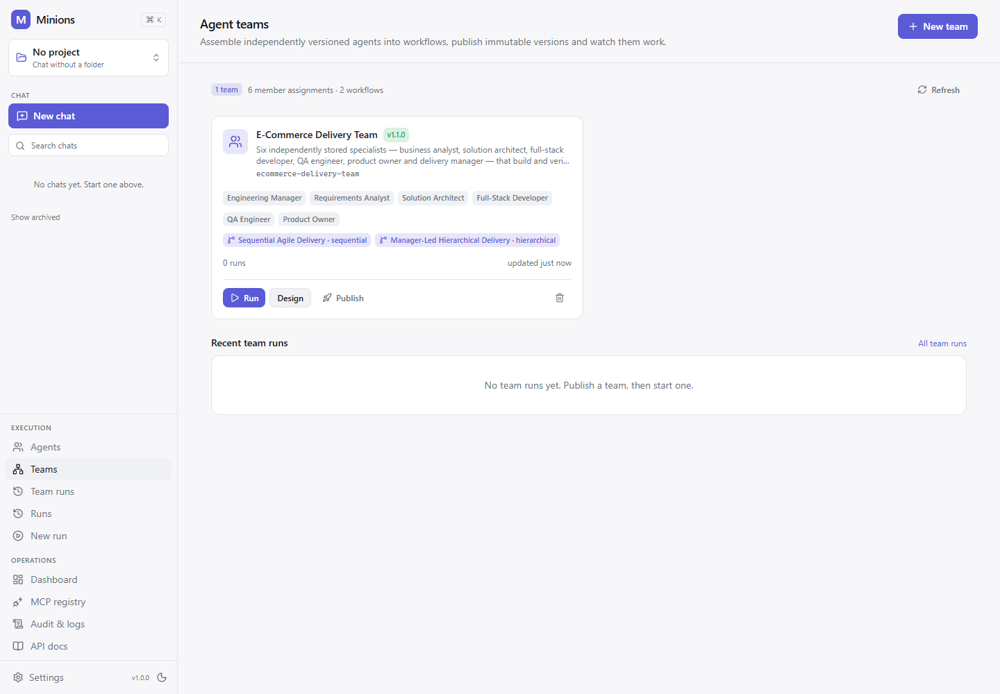
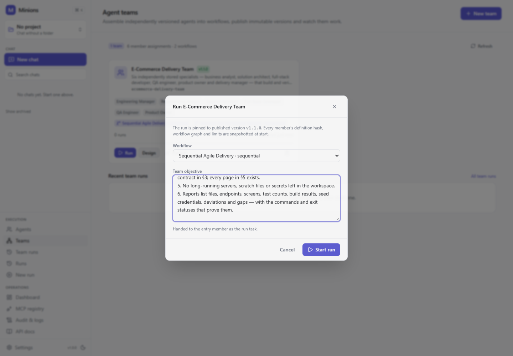
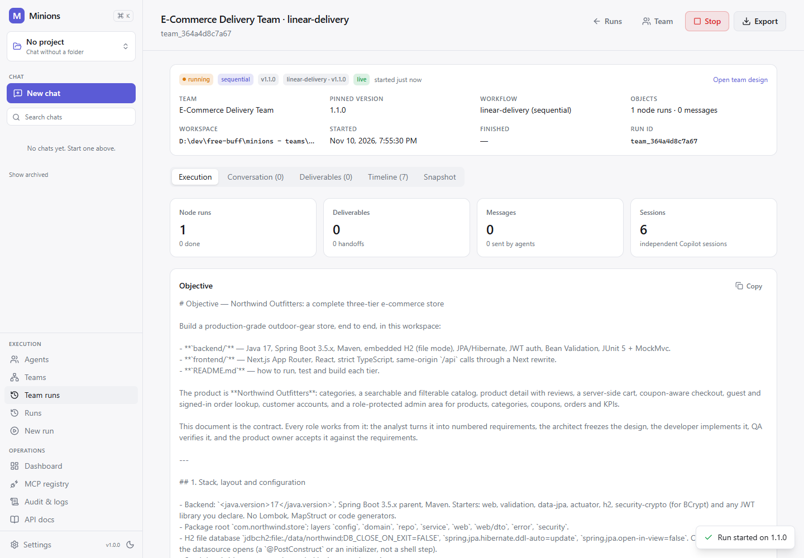

# Agent teams — a beginner's guide

This guide takes you from a clean install to a finished, auditable team run without editing
code. You start the sample team, run it, and read what it produced. Every step below is what
the acceptance run in [`UAT.md`](UAT.md) did in a real browser.

If you only want the reference material, jump to the [README](../README.md#teams-workflows-and-communication).

---

## 1. What a team is

An **agent** is one definition: persona, model, tools, knowledge and output expectations.
A **team** references those agents by pinned version and adds three things on top:

| Piece | What it decides |
| --- | --- |
| Members | Which agent fills each role (`lead`, `analyst`, `developer`, `qa`, …) |
| Workflow | The order work flows through them — `sequential`, `parallel`, `hierarchical`, `hybrid` |
| Limits | Delegation rules, turn budgets and what each step must produce |

Agents stay single-purpose and independently versioned. The team is the assembly. A **run**
pins one published team version plus a snapshot of every member, so the same run can be
explained months later even after the definitions change.

The shipped sample is the **Software Delivery Team**: five roles over the five shipped
role agents (`manager`, `architect`, `analyst`, `developer`, `qa`), with two workflows — sequential `agile-delivery` and hierarchical `manager-led`. `minions-ai init`
registers the agents, publishes the team and pins the members, so the team is runnable the
moment the server starts.

---

## 2. Prerequisites

- The Minions-ai executable for your OS (Windows, macOS or Linux)
- A model provider key (any OpenAI-compatible endpoint: MiMo, OpenAI, Azure, a local gateway)

Java 17+ and Maven are only needed to build an app the team generates — the platform itself
does not need them.

---

## 3. Five-minute quick start

### Install and start

Download the executable from the [latest release](https://github.com/siddharth-mishra-28/minions-ai/releases/latest), then:

```bat
minions-ai.exe init            # provider + key, then the agents and sample team
minions-ai.exe serve           # cockpit on http://127.0.0.1:3100
```

On macOS/Linux use `./minions-ai`. You can also run `minions-ai.exe ui` to open the cockpit
immediately.

Open <http://127.0.0.1:3100>. If you skipped `init`, the first screen is onboarding: choose
**Settings → Providers**, add your endpoint, model and key, and mark it as the default. The key
is stored on the server, never in the browser.

### Look at the team

Go to **Teams**. `software-delivery-team` is already there, published at `v2.0.0`, with five
member roles and two workflows.



Publishing freezes an immutable version — editing the team afterwards creates a new version,
never mutates a finished run. To change something, open **Design**, edit, **Validate** and
**Publish** again.

### Start a run

From **Teams**, press **Run** on the team card. Pick a workflow and paste the objective
(the acceptance run used a short product brief of its own):



Press **Start run**. The cockpit navigates to the live run page.

---

## 4. Reading a run

The run page has six tabs and never hides the raw record behind a summary.

| Tab | What you get |
| --- | --- |
| **Execution** | The execution tree: every node, member, attempt, status and duration, live |
| **Conversation** | The orchestrator-mediated messages between members (requests, reviews, decisions, handoffs) |
| **Deliverables** | Typed, versioned, content-hashed artifacts — download any of them |
| **Timeline** | The append-only audit event stream (`run.start`, `node.start`, `member.prompt.send`, `member.usage.capture`, `artifact.publish`, `edge.fire`, `node.end`, …) |
| **A2A** | The task as an A2A client sees it: state, artifacts and the JSON-RPC request to reproduce it |
| **Snapshot** | The pinned team version, workflow graph, member definition hashes and limits |

The **Execution** tab also carries a team-progress board: every member's state, percent,
phase and one-line summary. Progress is stored per member (`agent_run_member_progress`), so it
survives a restart and is visible without asking the member for a status message.

### Team chat

Members talk through the run's persisted message bus. A member emits `replies` (to, type,
short body) alongside its result JSON; the orchestrator validates the recipient, the
peer-to-peer policy and the message budget, then delivers accepted messages to the
recipient's next prompt. The **Conversation** tab filters to milestones (handoffs, reviews,
decisions) by default — progress chatter stays on the board, not in the transcript. Messages
are capped in length and count, both in the prompt and in the store, and artifacts carry the
detail. This works in **sequential, parallel, hierarchical and hybrid** workflows; the Team
Builder exposes `communication.enabled`, `allowPeerToPeer`, `maxRounds` and the total message
budget under **Communication**.



The header always shows the team, pinned version, workflow, workspace and run ID. **Stop**
ends the run safely (in-flight work is marked `aborted`); **Export** downloads the whole bundle
as JSON — the same bytes as `GET /api/team-runs/:id/export`.

A finished run is not just "green": every contracted artifact is on disk and attached to the
run, every member has its own session, and every model call is accounted for in the audit
trail.

---

## 5. The two sample workflows

**Sequential Agile Delivery** (`agile-delivery`) is the default and the easiest to read:

```
requirements → implementation → testing → completed
   analyst        developer        qa
```

Each node declares an output contract (`requirements-document`, `implementation-report`,
`test-results`). If QA returns `failed`, the workflow routes back to implementation with the QA
report attached; attempts and iteration limits stop the loop from spinning forever.

**Manager-Led Hierarchical Delivery** (`manager-led`) is for work that cannot be planned up
front. The `lead` member decomposes the objective with `team_delegate`, the runtime enforces
the delegation policy (`allowedMemberIds`, `maxDepth`, `maxConcurrentDelegates`), and the lead
reviews each specialist result before the next batch. Delegated work appears as its own nodes
in the same execution tree.

---

## 6. What good looks like

- `Validate` is clean and shows a hash before you publish; never run an unpublished team.
- The run reaches a terminal state (`done`) with every node green.
- Deliverables contain the contracted types with real content, not placeholders.
- The Timeline has `member.usage.capture` events — proof the runtime executed the turns.

The acceptance verifier was stricter than the cockpit: it re-ran the delivered product's test
suite, booted a fresh instance on an isolated database and exercised the whole HTTP contract
and CLI without reading the team's own reports. Run the same checks yourself for any delivery
you care about.

---

## 7. The same thing without the UI

```bash
# CLI, self-contained: register the agent, publish the team, run it and wait
minions-ai team run \
  --definition examples/software-delivery-team.agent-system.json \
  --workflow agile-delivery \
  --workspace ./app \
  --task "$(cat SPEC.md)" \
  --follow

# REST API against a running server
curl -sS -X POST http://127.0.0.1:3100/api/teams/software-delivery-team/runs \
  -H 'content-type: application/json' \
  -d "{\"workflowId\":\"agile-delivery\",\"workspace\":\"$PWD/app\",\"task\":$(jq -Rs . < SPEC.md)}"
```

The same flow runs in any CI: build or download one executable, prepare the agent and team,
run the workflow over a real brief, then verify the delivered product independently and smoke
the cockpit.

All entry points produce the same run record, so the acceptance evidence looks the same
whichever one you use.

---

## 8. A2A clients

Every published team is an A2A agent, so an external agent can drive it without the cockpit:

```bash
curl -s http://127.0.0.1:3100/.well-known/agent-card.json
curl -s http://127.0.0.1:3100/a2a/software-delivery-team/agent-card.json
curl -s -X POST http://127.0.0.1:3100/a2a/software-delivery-team \
  -H 'content-type: application/json' \
  -d '{"jsonrpc":"2.0","id":1,"method":"message/send","params":{"message":{"kind":"message","messageId":"m1","role":"user","parts":[{"kind":"text","text":"Ship the support desk"}]},"metadata":{"workflowId":"agile-delivery"}}}'
# then tasks/get with the returned task id, or message/stream for SSE
```

`/a2a/:teamId/members/:memberId` addresses one member; an existing `contextId` adds the
operator message to that run. The transport is loopback-only unless `A2A_TOKEN` is set. The
full method/alias list, task states and artifact mapping are in [A2A.md](A2A.md).

---

## 9. Troubleshooting

| Symptom | Fix |
| --- | --- |
| `Validate` reports unresolved pins | Register `full-stack-developer@1.0.0`, or re-run `minions-ai init` |
| `Run` button is disabled | The team has no published version yet — press **Publish** |
| Run ends `blocked` | A step did not satisfy its output contract; open Deliverables/Timeline and read the node error |
| Run ends `failed` with a provider error | Check **Settings → Providers**; `402` means the provider account has no balance |
| Empty execution tree | The run was started on another workspace, or the page is stale — refresh; the API is the source of truth |
| Two servers on one database | Not supported: one process per SQLite file |
